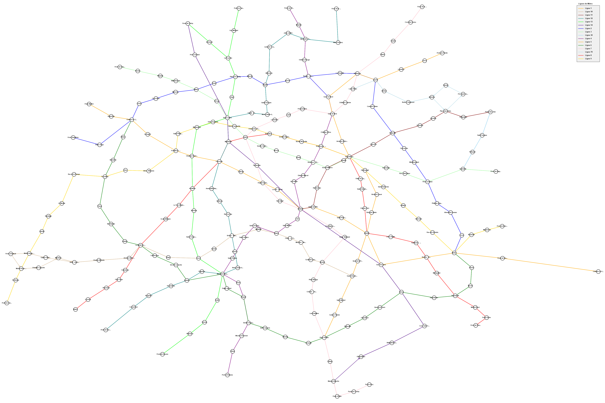

# Liv'in Paris

Console application in C# / .NET 8 for a neighbourhood meal-sharing platform in Paris: customers order dishes cooked by their neighbours, and deliveries are routed through the Paris metro network.

School project (ESILV), combining a MySQL database with graph algorithms.



## Features

**Platform management (MySQL)**
- Customers, cooks, dishes, orders and order lines
- Deliveries and order history

**Graph algorithms**
- Paris metro modelled as a weighted graph (stations, lines, travel and connection times) loaded from `feuillenoeuds3.txt` and `feuilleliens3.txt`
- Shortest delivery route between a cook and a customer with **Dijkstra**, **Bellman-Ford** and **Floyd-Warshall**, to compare the three approaches
- Connectivity check (DFS)
- Customer–cook relationship graph coloured with the **Welsh-Powell** algorithm
- Graph rendering to PNG (`System.Drawing`)

**Tests**: 25 MSTest unit tests (`UnitTest1.cs`).

## How to run

Requirements: .NET 8 SDK, a MySQL server with a `livinparis` database.

1. Set the database connection string in the `LIVINPARIS_DB` environment variable (template in [`.env.example`](.env.example)):

   ```powershell
   # Windows (PowerShell)
   $env:LIVINPARIS_DB = "Server=localhost;Database=livinparis;Uid=root;Pwd=YOUR_PASSWORD;"
   ```

   ```bash
   # macOS / Linux
   export LIVINPARIS_DB="Server=localhost;Database=livinparis;Uid=root;Pwd=YOUR_PASSWORD;"
   ```

2. Open `LivinParis S2.sln` in Visual Studio (or run `dotnet run`) and start the project. The application opens an interactive console menu.

NuGet dependencies: `MySql.Data`, `Newtonsoft.Json`, `System.Drawing.Common`.

## Tech stack

C# · .NET 8 · MySQL · object-oriented design (models / services) · graph algorithms · MSTest

## Author

**Noé Payan** — Engineering student in Data & Artificial Intelligence, ESILV (Paris)
